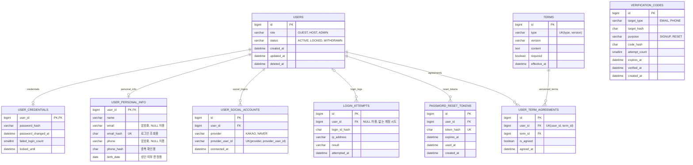
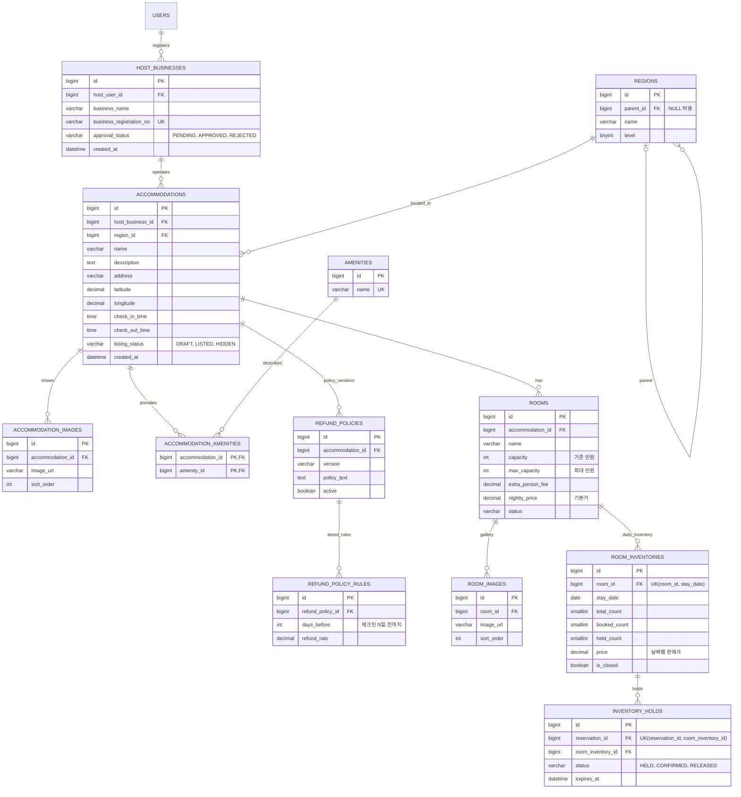
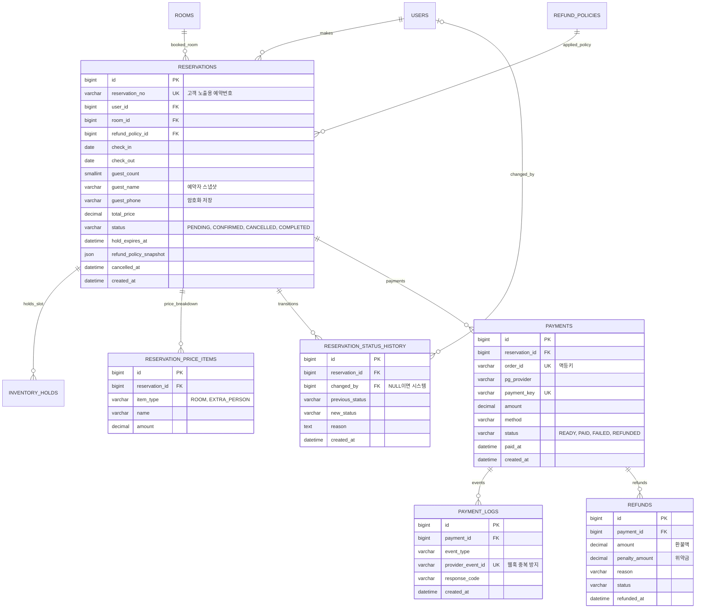
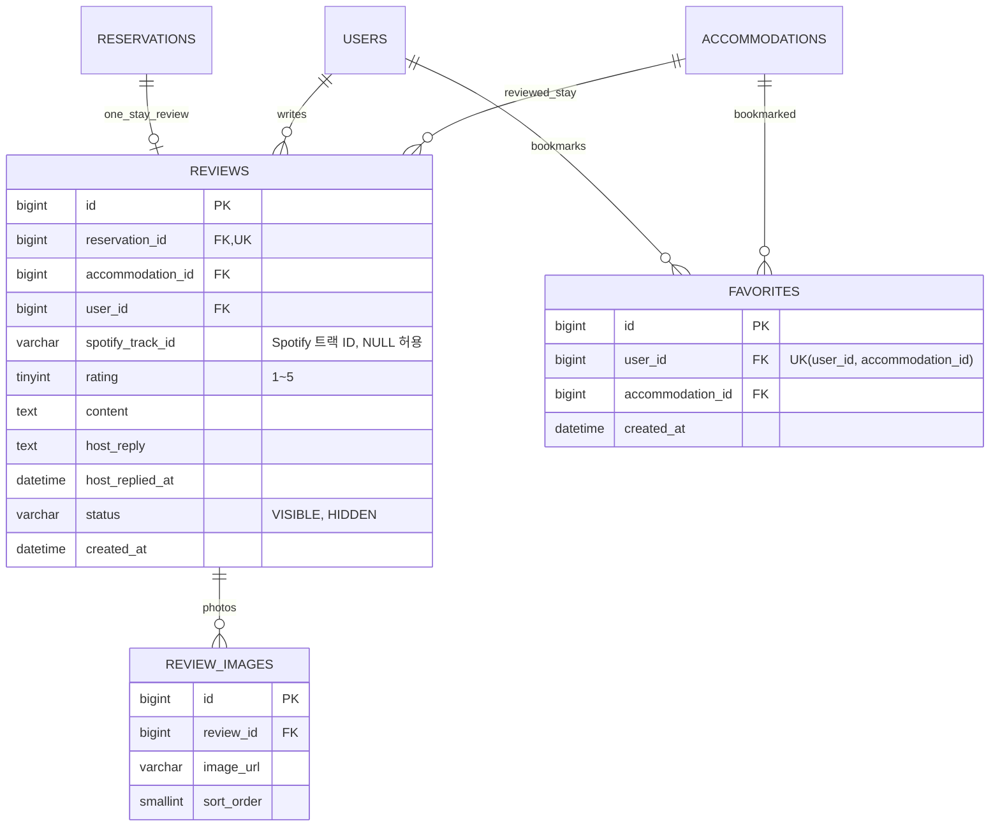

# StayBook 데이터베이스 설계 (ERD)

StayBook은 숙박 예약 서비스입니다. 이 문서는 1차 구현(MVP)의 데이터베이스 구조를 처음 보는 사람도 이해할 수 있도록 정리한 것입니다. 총 **30개 테이블**로 아래 한 사이클을 처리합니다.

> **회원가입 → 숙소 조회 → 예약 → 결제 → 취소/환불 → 리뷰**

---

## 1. 이 문서 읽는 법

**ERD 표기 (Mermaid)**

| 표기 | 의미 |
|---|---|
| `PK` | 기본키. 행을 구분하는 고유 값 |
| `FK` | 외래키. 다른 테이블의 PK를 가리킴 |
| `UK` | 유니크 키. 중복 불가 |
| `\|\|--o{` | 1 대 다(多). 예: 회원 1명이 예약 여러 건 |
| `\|\|--o\|` | 1 대 0 또는 1. 예: 회원 1명당 인증정보 최대 1개 |
| `\|o--o{` | 0 또는 1 대 다. 부모가 없을 수도 있는 관계 |

**테이블 구성**

| 도메인 | 테이블 수 | 한 줄 설명 |
|---|---|---|
| A. 회원·인증·약관 | 9 | 누가 가입했고, 어떻게 로그인하고, 어떤 약관에 동의했는가 |
| B. 호스트·숙소·객실·재고 | 12 | 누가 어떤 숙소와 객실을 어떤 가격, 어떤 재고로 파는가 |
| C. 예약·결제·환불 | 6 | 누가 무엇을 예약했고, 얼마를 결제했고, 얼마를 돌려받았는가 |
| D. 리뷰·찜 | 3 | 투숙 후기와 관심 숙소 |

**도메인 간 큰 흐름**

```
USERS ──(예약)──▶ RESERVATIONS ──(객실)──▶ ROOMS ──▶ ACCOMMODATIONS ──▶ HOST_BUSINESSES ──▶ USERS(호스트)
                      │
                      ├──▶ INVENTORY_HOLDS ──▶ ROOM_INVENTORIES   (날짜별 재고 선점)
                      ├──▶ PAYMENTS ──▶ REFUNDS                    (결제와 환불)
                      └──▶ REVIEWS                                 (투숙 후 리뷰)
```

---

## 2. 1차 구현 범위와 정책

| 항목 | 1차 정책 |
|---|---|
| 숙박 형태 | 숙박(1박 이상)만 지원. 대실(시간 단위)은 지원하지 않음 |
| 예약 단위 | 예약 1건 = 객실 1개 |
| 로그인 | 이메일 + 비밀번호, 소셜 로그인(카카오·네이버) |
| 토큰 | 리프레시 토큰은 Redis에 저장. DB 테이블 없음 |
| 미성년자 | 만 14세 이상이면 가입 가능. 예약은 성인만 가능 |
| 호스트 | 사업자 등록 시 자동 승인. 관리자 심사 화면 없음 |
| 결제 | PG사 1곳, 즉시 결제. 카드 저장(빌링키) 없음 |
| 할인 | 없음. 쿠폰·기획전 없음 |
| 정산 | 없음. 예약·결제 데이터만 쌓음 |
| 리뷰 음악 | Spotify 트랙 ID만 저장하고 공식 임베드 플레이어로 표시 |

---

## 3. A. 회원·인증·약관 (9개)

### 개념 설명

- 회원의 **신원(USERS)**, **비밀번호 정보(USER_CREDENTIALS)**, **개인정보(USER_PERSONAL_INFO)**, **소셜 연결(USER_SOCIAL_ACCOUNTS)** 을 분리해서 저장합니다. 개인정보와 인증정보를 나눠 두면 접근 권한과 암호화 정책을 따로 적용하기 쉽습니다.
- 이메일·전화번호는 **암호화해서 저장**하고, 조회·중복 확인용으로는 **해시 컬럼**(`email_hash`, `phone_hash`)을 따로 둡니다.
- 소셜로만 가입한 회원은 비밀번호가 없으므로 `USER_CREDENTIALS` 행이 없을 수 있습니다.
- `VERIFICATION_CODES`(인증번호)는 가입 전에도 쓰이므로 `USERS`와 FK가 없습니다. 의도된 설계입니다.

### ERD



### 테이블 설명

| 테이블 | 역할 | 핵심 포인트 |
|---|---|---|
| `USERS` | 회원의 기본 신원. 모든 회원 관련 테이블의 기준 | `role`(GUEST/HOST/ADMIN), `status`(ACTIVE/LOCKED/WITHDRAWN). 탈퇴는 `deleted_at` 기록 방식 |
| `USER_CREDENTIALS` | 이메일 로그인용 비밀번호 정보 | 비밀번호는 해시로만 저장. 로그인 실패 횟수와 잠금 해제 시각 관리. 소셜 전용 회원은 행 없음 |
| `USER_PERSONAL_INFO` | 이름, 이메일, 전화번호, 생년월일 | 이메일·전화는 암호화. 소셜 제공자가 이메일을 주지 않을 수 있어 NULL 허용. `birth_date`로 성인 여부 판정 |
| `USER_SOCIAL_ACCOUNTS` | 소셜 로그인 연결 정보 | 한 회원이 여러 소셜 계정을 연결 가능(1:N). `(provider, provider_user_id)` 유니크 |
| `LOGIN_ATTEMPTS` | 로그인 시도 기록 | 존재하지 않는 계정으로 시도한 경우도 기록하므로 `user_id` NULL 허용 |
| `VERIFICATION_CODES` | 이메일·휴대폰 인증번호 | 가입·비밀번호 재설정용. 시도 5회 초과 시 코드 무효화. 가입 전에도 쓰이므로 USERS와 FK 없음 |
| `PASSWORD_RESET_TOKENS` | 비밀번호 재설정 링크용 토큰 | 토큰은 해시로 저장. 만료 시각과 사용 시각 기록 |
| `TERMS` | 약관 원문 (종류·버전별) | `(type, version)` 유니크. `required`로 필수/선택 구분 |
| `USER_TERM_AGREEMENTS` | 회원별 약관 동의 이력 | `(user_id, term_id)` 유니크. 어떤 버전에 동의했는지 추적 |

### 소셜 로그인 규칙

- 소셜 제공자의 액세스 토큰은 저장하지 않습니다. 로그인 시점에 `provider_user_id` 확인용으로만 사용합니다.
- 최초 소셜 로그인이면 `USERS` + `USER_PERSONAL_INFO` + `USER_SOCIAL_ACCOUNTS`를 **한 트랜잭션**으로 생성합니다.
- 소셜에서 받은 이메일이 기존 회원의 `email_hash`와 같으면 자동 병합하지 않습니다. 기존 계정으로 로그인한 뒤 연결하도록 안내합니다.
- 약관 동의와 생년월일은 소셜에서 받을 수 없으므로 최초 로그인 직후 추가 입력 단계가 필요합니다.

### 미성년자 규칙

- 만 14세 미만은 가입할 수 없습니다. 법정대리인 동의 절차가 필요한데 1차에는 없습니다.
- 만 14세 이상 미성년자는 가입, 숙소 조회, 찜까지 가능합니다.
- 예약 생성 시 `birth_date`로 성인 여부를 검사하고, 미성년자면 거부합니다.
- 생년월일은 자기 신고 값입니다. 본인인증과 보호자 동의는 1차 범위 밖입니다.

### Redis 키 설계

DB 테이블 대신 Redis에 저장하는 값입니다.

| 키 | 값 | TTL | 용도 |
|---|---|---|---|
| `refresh:{userId}:{tokenId}` | 토큰 해시, user agent, IP | 14일 | 리프레시 토큰. 재발급 시 기존 키 삭제 후 새로 발급 |
| `oauth:state:{state}` | 리다이렉트 정보 | 5분 | 소셜 로그인 CSRF 방지 |
| `spotify:app_token` | Spotify 앱 액세스 토큰 | 만료 시각까지 | 트랙 검색 API 호출용 |

- 로그아웃은 해당 `refresh` 키를 삭제합니다. 전체 기기 로그아웃은 `refresh:{userId}:*`를 삭제합니다.
- 비밀번호 변경이나 탈퇴 시에도 해당 회원의 `refresh` 키를 전부 삭제합니다.

---

## 4. B. 호스트·숙소·객실·재고 (12개)

### 개념 설명

- 숙소는 **호스트(사업자) → 숙소 → 객실** 계층입니다. 호스트가 사업자 정보를 등록하고(`HOST_BUSINESSES`), 사업자 아래에 숙소(`ACCOMMODATIONS`), 숙소 아래에 객실(`ROOMS`)이 있습니다.
- 객실의 가격과 재고는 **날짜별로** `ROOM_INVENTORIES`에 한 행씩 저장합니다. "5월 3일 디럭스룸: 총 5개, 예약 2개, 선점 1개, 가격 12만원" 같은 형태입니다.
- 결제 전 동시 예약을 막기 위해 재고를 잠시 잡아두는 장치가 `INVENTORY_HOLDS`입니다. 2박 예약이면 hold 행이 2개 생깁니다.
- 환불 규정은 숙소별로 버전 관리합니다(`REFUND_POLICIES`). 세부 구간은 `REFUND_POLICY_RULES`(예: 체크인 3일 전까지 100% 환불)에 둡니다.
- 지역(`REGIONS`)은 자기 자신을 부모로 참조하는 트리 구조입니다(예: 서울 > 강남구).

### ERD



### 테이블 설명

| 테이블 | 역할 | 핵심 포인트 |
|---|---|---|
| `HOST_BUSINESSES` | 호스트의 사업자 정보 | 1차는 사업자등록번호 형식 검증을 통과하면 바로 `APPROVED`로 저장하고 `USERS.role`을 HOST로 변경. `approval_status`는 이후 심사 기능을 위해 유지 |
| `REGIONS` | 지역 (시·도 > 시·군·구) | `parent_id`로 자기 참조. `level`은 계층 깊이 |
| `ACCOMMODATIONS` | 숙소 | `listing_status`: DRAFT(작성 중) / LISTED(노출) / HIDDEN(숨김). 체크인·체크아웃 시각 포함 |
| `ACCOMMODATION_IMAGES` | 숙소 사진 | `sort_order`로 노출 순서 |
| `AMENITIES` | 편의시설 마스터 (와이파이, 주차 등) | 이름 유니크 |
| `ACCOMMODATION_AMENITIES` | 숙소와 편의시설의 다대다 연결 | 복합 PK `(accommodation_id, amenity_id)` |
| `ROOMS` | 객실 종류 | `capacity`는 기준 인원, `max_capacity`는 최대 인원. 기준 인원 초과 시 `extra_person_fee` 추가. `nightly_price`는 기본가 |
| `ROOM_IMAGES` | 객실 사진 | `sort_order`로 노출 순서 |
| `ROOM_INVENTORIES` | 객실의 날짜별 재고·가격 | `(room_id, stay_date)` 유니크. `total_count`, `booked_count`(확정), `held_count`(선점 중), `price`(그 날짜 판매가), `is_closed`(판매 중지) |
| `INVENTORY_HOLDS` | 결제 대기 중 재고 임시 선점 | 상태 HELD → CONFIRMED(결제 완료) 또는 RELEASED(만료·취소). `expires_at` 이후 자동 해제 |
| `REFUND_POLICIES` | 숙소별 환불 정책 (버전 관리) | `active`로 현재 적용 중인 버전 표시 |
| `REFUND_POLICY_RULES` | 환불 구간 규칙 | "체크인 `days_before`일 전까지 `refund_rate` 환불" 형태 |

### 재고 처리 규칙 (구현 시 합의 필요)

- **선점**: 아래와 같은 조건부 UPDATE로 처리합니다. 영향 행이 0이면 매진입니다.
  ```sql
  UPDATE room_inventories
  SET held_count = held_count + 1
  WHERE booked_count + held_count < total_count AND is_closed = false
  ```
- **결제 완료**: `held_count - 1`, `booked_count + 1`, hold 상태를 CONFIRMED로 변경합니다.
- **만료**: `expires_at`이 지난 HELD 건을 배치로 RELEASED 처리하고 `held_count - 1` 합니다.

---

## 5. C. 예약·결제·환불 (6개)

### 개념 설명

- `RESERVATIONS`가 중심입니다. 예약 시점의 **예약자 이름·연락처**와 **환불 정책(JSON 스냅샷)** 을 함께 저장해서, 이후 회원 정보나 정책이 바뀌어도 예약 당시 내용이 보존됩니다.
- 금액은 `total_price` 하나만 두지 않고 항목별 내역을 `RESERVATION_PRICE_ITEMS`에 저장합니다(객실 요금, 추가 인원 요금).
- 예약 상태가 바뀔 때마다 `RESERVATION_STATUS_HISTORY`에 이력을 남깁니다. 시스템이 바꾼 경우 `changed_by`는 NULL입니다.
- 결제는 `PAYMENTS`, PG사에서 오는 이벤트(웹훅 등)는 `PAYMENT_LOGS`, 환불은 `REFUNDS`에 기록합니다.
- 취소 시각은 `RESERVATIONS.cancelled_at`, 위약금은 `REFUNDS.penalty_amount`에 기록합니다. 환불은 결제를 통해 예약과 연결됩니다.

### ERD



### 테이블 설명

| 테이블 | 역할 | 핵심 포인트 |
|---|---|---|
| `RESERVATIONS` | 예약 본체 | `reservation_no`는 고객에게 보여주는 예약번호. 상태: PENDING(결제 대기) → CONFIRMED(확정) → COMPLETED(투숙 완료) / CANCELLED(취소). `hold_expires_at`은 결제 제한 시간 |
| `RESERVATION_PRICE_ITEMS` | 예약 금액 항목별 내역 | `item_type`: ROOM(객실 요금), EXTRA_PERSON(추가 인원 요금) |
| `RESERVATION_STATUS_HISTORY` | 예약 상태 변경 이력 | 이전·이후 상태, 사유, 변경 주체 기록 |
| `PAYMENTS` | 결제 건 | `order_id`는 중복 결제 방지용 멱등키, `payment_key`는 PG사 결제 식별자. 상태: READY / PAID / FAILED / REFUNDED |
| `PAYMENT_LOGS` | PG 이벤트 로그 | `provider_event_id` 유니크로 같은 웹훅이 두 번 처리되는 것을 방지 |
| `REFUNDS` | 환불 내역 | `amount`는 실제 환불액, `penalty_amount`는 위약금 |

### 예약 생성 조건

- 예약자는 성인이어야 합니다 (`USER_PERSONAL_INFO.birth_date` 기준).
- `guest_count`는 `ROOMS.max_capacity` 이하여야 합니다.

### 금액 규칙

- `total_price` = `RESERVATION_PRICE_ITEMS.amount`의 합계
- ROOM 항목 = 숙박일별 `ROOM_INVENTORIES.price`의 합
- EXTRA_PERSON 항목 = `(guest_count - capacity) × extra_person_fee × 박수`

---

## 6. D. 리뷰·찜 (3개)

### 개념 설명

- 리뷰는 **예약 1건당 1개**만 작성할 수 있습니다(`reservation_id` 유니크). 실제로 투숙한 사람만 쓸 수 있게 하기 위한 구조입니다.
- 리뷰에 음악을 붙일 수 있습니다. Spotify 곡의 **트랙 ID 문자열만** 저장하고, 제목·커버 등 메타데이터는 DB에 보관하지 않습니다. 외부 테이블 FK가 아닌 단순 문자열입니다.
- 호스트는 리뷰에 답글을 달 수 있습니다(`host_reply`).
- 찜은 회원과 숙소의 관계만 저장합니다.

### ERD



### 테이블 설명

| 테이블 | 역할 | 핵심 포인트 |
|---|---|---|
| `REVIEWS` | 투숙 리뷰 | 평점 1~5, 본문, 호스트 답글과 답글 시각, 노출 상태(VISIBLE/HIDDEN), 선택적 `spotify_track_id` |
| `REVIEW_IMAGES` | 리뷰 사진 | `sort_order`로 노출 순서 |
| `FAVORITES` | 찜한 숙소 | `(user_id, accommodation_id)` 유니크. 같은 숙소를 중복해서 찜할 수 없음 |

### Spotify 연동 방식

- **리뷰 작성**: 백엔드가 Spotify 검색 API를 호출해 결과를 프론트에 전달하고, 사용자가 고른 트랙의 ID만 저장합니다.
- **리뷰 표시**: `https://open.spotify.com/embed/track/{spotify_track_id}` 공식 임베드 플레이어를 사용합니다. 제목·커버·재생은 Spotify가 직접 그립니다.
- `preview_url`은 Spotify API에서 deprecated되어 사용하지 않습니다.
- 리뷰 사진과 음악을 동기화해 자동 재생하는 연출은 Spotify 개발자 약관 위반 소지가 있어 하지 않습니다. 플레이어는 사용자가 직접 재생합니다.
- 출시 전 Spotify Developer Terms와 Design Guidelines를 한 번 확인해야 합니다.

---

## 7. 1차 범위 밖 기능

아래 기능은 1차에서 구현하지 않으며, 필요해질 때 테이블을 추가합니다.

| 묶음 | 내용 |
|---|---|
| 보안 강화 | 비밀번호 이력, 기기 관리, MFA, 차단·이상거래 탐지, 보안 감사 로그 |
| 결제수단 저장 | 카드 저장(빌링키) |
| 법령·감사 | 본인인증, 개인정보 열람·파기 기록, 관리자 행위 로그 |
| 호스트 심사·정산 | 심사 이력, 호스트 계좌, 정산 |
| 대실·옵션 | 시간 단위 대실, 숙소·예약 옵션 |
| 예약 부가 | 별도 취소 테이블, 보호자 동의 |
| 고객센터 | 신고, 문의, 공지, FAQ, 알림 |
| 마케팅 | 쿠폰, 기획전, 최근 본 상품, 통계 |
